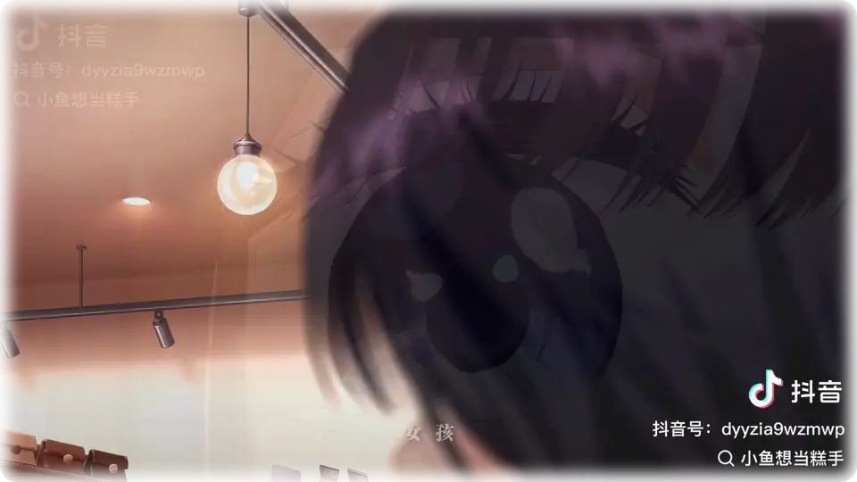
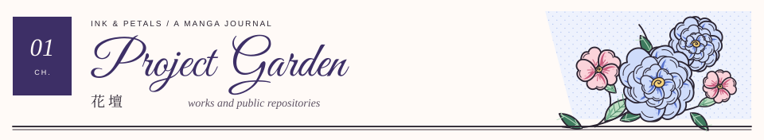
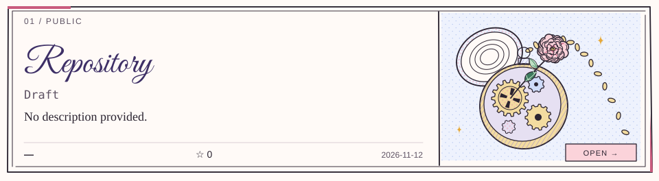
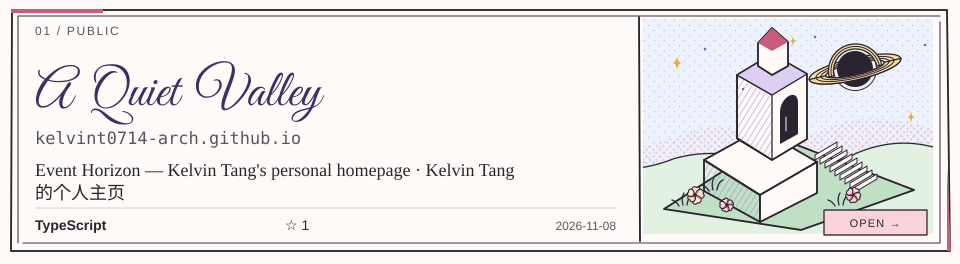
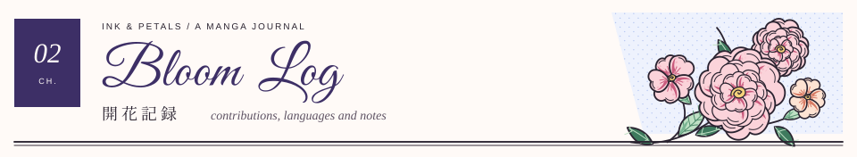
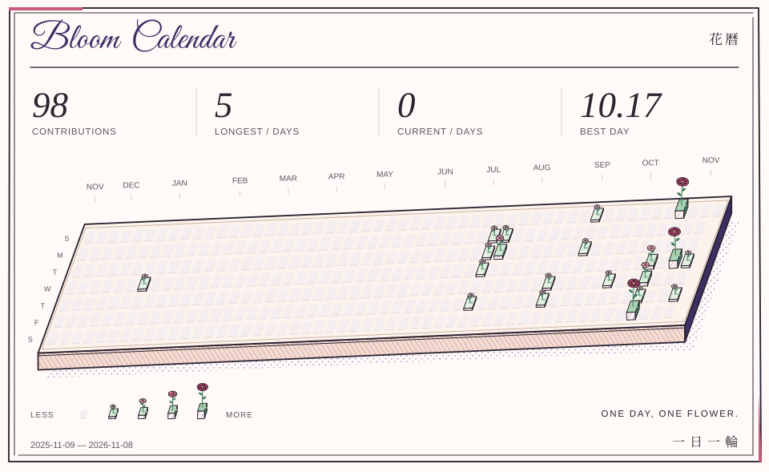
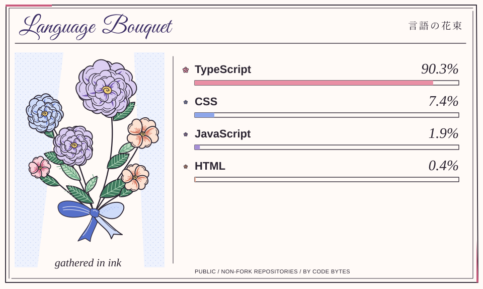
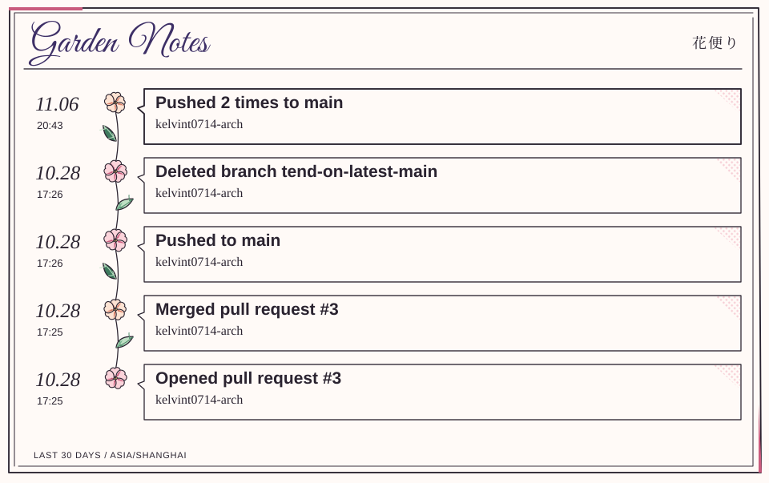
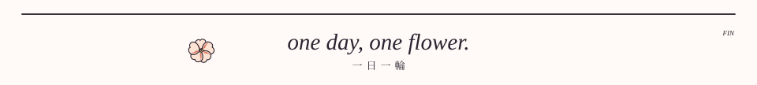

<!-- BANNER:START -->
<picture>
  <source media="(prefers-reduced-motion: reduce)" srcset="./assets/banner-static.webp" />
  
</picture>
<!-- BANNER:END -->

<!-- Everything below the banner is drawn by scripts/ into assets/. Edit the scripts, not the SVGs: see MAINTENANCE.md. -->

<picture>
  <source media="(max-width: 600px) and (prefers-color-scheme: dark)" srcset="./assets/sections/header-garden-dark-mobile.svg" />
  <source media="(max-width: 600px)" srcset="./assets/sections/header-garden-light-mobile.svg" />
  <source media="(prefers-color-scheme: dark)" srcset="./assets/sections/header-garden-dark.svg" />
  
</picture>

<!-- GARDEN-REPOS:START -->
<a href="https://github.com/kelvint0714-arch/Draft">
<picture>
  <source media="(max-width: 600px) and (prefers-color-scheme: dark)" srcset="./assets/repos/draft-ebf12ef-dark-mobile.svg" />
  <source media="(max-width: 600px)" srcset="./assets/repos/draft-ebf12ef-light-mobile.svg" />
  <source media="(prefers-color-scheme: dark)" srcset="./assets/repos/draft-ebf12ef-dark.svg" />
  
</picture>
</a>

<a href="https://github.com/kelvint0714-arch/kelvint0714-arch.github.io">
<picture>
  <source media="(max-width: 600px) and (prefers-color-scheme: dark)" srcset="./assets/repos/kelvint0714-arch-github-io-b5ab2e7-dark-mobile.svg" />
  <source media="(max-width: 600px)" srcset="./assets/repos/kelvint0714-arch-github-io-b5ab2e7-light-mobile.svg" />
  <source media="(prefers-color-scheme: dark)" srcset="./assets/repos/kelvint0714-arch-github-io-b5ab2e7-dark.svg" />
  
</picture>
</a>

Repository text index / 仓库文字索引

<a href="https://github.com/kelvint0714-arch/Draft"><strong>Draft</strong></a> No description provided. Language not specified

<a href="https://github.com/kelvint0714-arch/kelvint0714-arch.github.io"><strong>kelvint0714-arch.github.io</strong></a> Event Horizon — Kelvin Tang&#x27;s personal homepage · Kelvin Tang 的个人主页 TypeScript

<!-- GARDEN-REPOS:END -->

<picture>
  <source media="(max-width: 600px) and (prefers-color-scheme: dark)" srcset="./assets/sections/header-bloom-dark-mobile.svg" />
  <source media="(max-width: 600px)" srcset="./assets/sections/header-bloom-light-mobile.svg" />
  <source media="(prefers-color-scheme: dark)" srcset="./assets/sections/header-bloom-dark.svg" />
  
</picture>

<picture>
  <source media="(max-width: 600px) and (prefers-color-scheme: dark)" srcset="./assets/metrics/calendar-dark-mobile.svg" />
  <source media="(max-width: 600px)" srcset="./assets/metrics/calendar-light-mobile.svg" />
  <source media="(prefers-color-scheme: dark)" srcset="./assets/metrics/calendar-dark.svg" />
  
</picture>

<picture>
  <source media="(max-width: 600px) and (prefers-color-scheme: dark)" srcset="./assets/metrics/bouquet-dark-mobile.svg" />
  <source media="(max-width: 600px)" srcset="./assets/metrics/bouquet-light-mobile.svg" />
  <source media="(prefers-color-scheme: dark)" srcset="./assets/metrics/bouquet-dark.svg" />
  
</picture>

<picture>
  <source media="(max-width: 600px) and (prefers-color-scheme: dark)" srcset="./assets/metrics/notes-dark-mobile.svg" />
  <source media="(max-width: 600px)" srcset="./assets/metrics/notes-light-mobile.svg" />
  <source media="(prefers-color-scheme: dark)" srcset="./assets/metrics/notes-dark.svg" />
  
</picture>

<picture>
  <source media="(max-width: 600px) and (prefers-color-scheme: dark)" srcset="./assets/sections/footer-dark-mobile.svg" />
  <source media="(max-width: 600px)" srcset="./assets/sections/footer-light-mobile.svg" />
  <source media="(prefers-color-scheme: dark)" srcset="./assets/sections/footer-dark.svg" />
  
</picture>
