<!-- BANNER:START -->
<!-- BANNER:END -->

<picture>
  <source media="(prefers-color-scheme: dark)" srcset="./assets/sections/header-garden-dark.svg" />
  
</picture>

<!-- GARDEN-REPOS:START -->
| | Repository | Description | Language |
| :-: | :--- | :--- | :--- |
| ✿ | [kelvint0714-arch.github.io](https://github.com/kelvint0714-arch/kelvint0714-arch.github.io) | Event Horizon — Kelvin Tang's personal homepage · Kelvin Tang 的个人主页 | TypeScript |
| ❀ | [ML-practice](https://github.com/kelvint0714-arch/ML-practice) | this | Jupyter Notebook |
<!-- GARDEN-REPOS:END -->

<picture>
  <source media="(prefers-color-scheme: dark)" srcset="./assets/sections/header-bloom-dark.svg" />
  
</picture>

<picture>
  <source media="(prefers-color-scheme: dark)" srcset="./assets/metrics/calendar-dark.svg" />
  
</picture>

  <picture>
    <source media="(prefers-color-scheme: dark)" srcset="./assets/metrics/bouquet-dark.svg" />
    
  </picture>
  <picture>
    <source media="(prefers-color-scheme: dark)" srcset="./assets/metrics/notes-dark.svg" />
    
  </picture>

✿ 一日一輪 · every flower here is drawn in code and refreshed daily ✿

