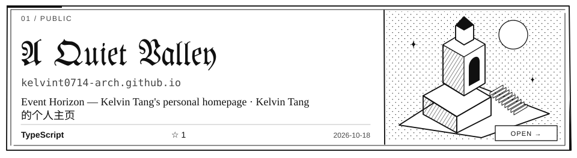
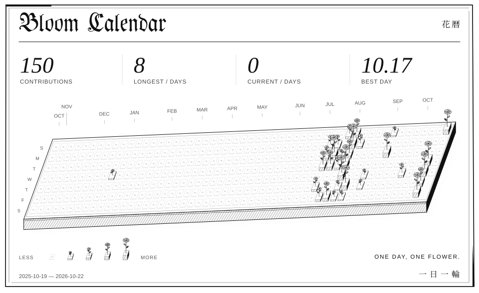
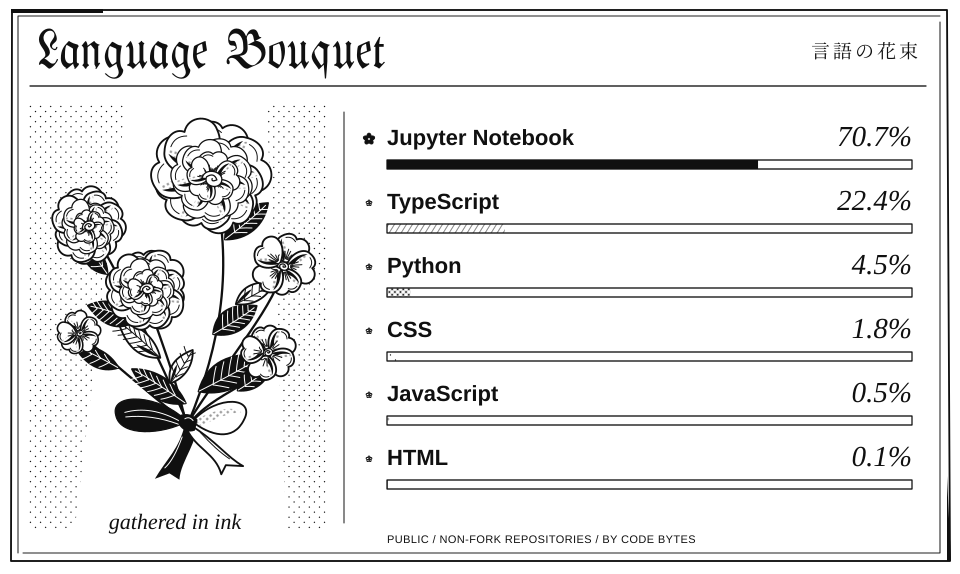
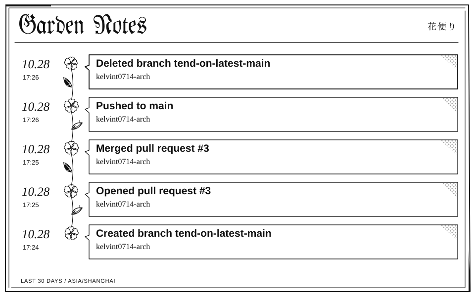

<!-- BANNER:START -->
<picture>
  <source media="(prefers-reduced-motion: reduce)" srcset="./assets/banner-static.webp" />
  
</picture>
<!-- BANNER:END -->

<!-- MANGA-EDITION: ink-v2 / ALL non-video visuals: paper, ink, hatching and screentone -->

<picture>
  <source media="(max-width: 600px) and (prefers-color-scheme: dark)" srcset="./assets/ink-v2/sections/header-garden-dark-mobile.svg" />
  <source media="(max-width: 600px)" srcset="./assets/ink-v2/sections/header-garden-light-mobile.svg" />
  <source media="(prefers-color-scheme: dark)" srcset="./assets/ink-v2/sections/header-garden-dark.svg" />
  
</picture>

<!-- GARDEN-REPOS:START -->
<a href="https://github.com/kelvint0714-arch/kelvint0714-arch.github.io">
<picture>
  <source media="(max-width: 600px) and (prefers-color-scheme: dark)" srcset="./assets/ink-v2/repos/kelvint0714-arch-github-io-b5ab2e7-dark-mobile.svg" />
  <source media="(max-width: 600px)" srcset="./assets/ink-v2/repos/kelvint0714-arch-github-io-b5ab2e7-light-mobile.svg" />
  <source media="(prefers-color-scheme: dark)" srcset="./assets/ink-v2/repos/kelvint0714-arch-github-io-b5ab2e7-dark.svg" />
  
</picture>
</a>

<a href="https://github.com/kelvint0714-arch/ML-practice">
<picture>
  <source media="(max-width: 600px) and (prefers-color-scheme: dark)" srcset="./assets/ink-v2/repos/ml-practice-0c95dec-dark-mobile.svg" />
  <source media="(max-width: 600px)" srcset="./assets/ink-v2/repos/ml-practice-0c95dec-light-mobile.svg" />
  <source media="(prefers-color-scheme: dark)" srcset="./assets/ink-v2/repos/ml-practice-0c95dec-dark.svg" />
  
</picture>
</a>

Repository text index / 仓库文字索引

<a href="https://github.com/kelvint0714-arch/kelvint0714-arch.github.io"><strong>kelvint0714-arch.github.io</strong></a> Event Horizon — Kelvin Tang&#x27;s personal homepage · Kelvin Tang 的个人主页 TypeScript

<a href="https://github.com/kelvint0714-arch/ML-practice"><strong>ML-practice</strong></a> this Jupyter Notebook

<!-- GARDEN-REPOS:END -->

<picture>
  <source media="(max-width: 600px) and (prefers-color-scheme: dark)" srcset="./assets/ink-v2/sections/header-bloom-dark-mobile.svg" />
  <source media="(max-width: 600px)" srcset="./assets/ink-v2/sections/header-bloom-light-mobile.svg" />
  <source media="(prefers-color-scheme: dark)" srcset="./assets/ink-v2/sections/header-bloom-dark.svg" />
  
</picture>

<picture>
  <source media="(max-width: 600px) and (prefers-color-scheme: dark)" srcset="./assets/ink-v2/metrics/calendar-dark-mobile.svg" />
  <source media="(max-width: 600px)" srcset="./assets/ink-v2/metrics/calendar-light-mobile.svg" />
  <source media="(prefers-color-scheme: dark)" srcset="./assets/ink-v2/metrics/calendar-dark.svg" />
  
</picture>

<picture>
  <source media="(max-width: 600px) and (prefers-color-scheme: dark)" srcset="./assets/ink-v2/metrics/bouquet-dark-mobile.svg" />
  <source media="(max-width: 600px)" srcset="./assets/ink-v2/metrics/bouquet-light-mobile.svg" />
  <source media="(prefers-color-scheme: dark)" srcset="./assets/ink-v2/metrics/bouquet-dark.svg" />
  
</picture>

<picture>
  <source media="(max-width: 600px) and (prefers-color-scheme: dark)" srcset="./assets/ink-v2/metrics/notes-dark-mobile.svg" />
  <source media="(max-width: 600px)" srcset="./assets/ink-v2/metrics/notes-light-mobile.svg" />
  <source media="(prefers-color-scheme: dark)" srcset="./assets/ink-v2/metrics/notes-dark.svg" />
  
</picture>

<picture>
  <source media="(max-width: 600px) and (prefers-color-scheme: dark)" srcset="./assets/ink-v2/sections/footer-dark-mobile.svg" />
  <source media="(max-width: 600px)" srcset="./assets/ink-v2/sections/footer-light-mobile.svg" />
  <source media="(prefers-color-scheme: dark)" srcset="./assets/ink-v2/sections/footer-dark.svg" />
  
</picture>
